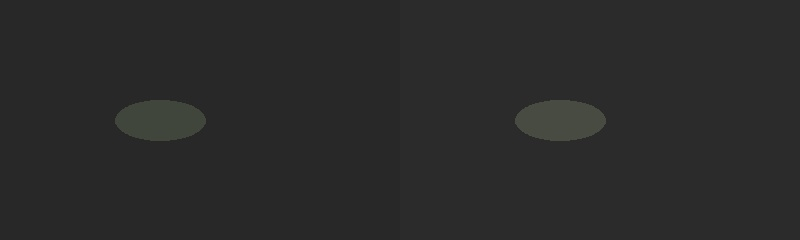

# 水下鱼类检测、增强与跟踪

本科项目的工程展示，串联视频抽帧、图像增强、YOLOv8 四类目标检测和 DeepSORT 轨迹关联。原项目还探索了 Farneback 光流辅助框位置调整。



## 流程与目录

`视频 → 可选 CLAHE → YOLO 检测 → DeepSORT 关联 → 带 ID 视频 / CSV`

- `run.py`，本次整理的可移植入口。
- `legacy/`，路径清理后的原项目应用脚本，展示原始实验实现。
- `results/train63.csv`，历史 YOLO 训练记录。
- `docs/RESULTS.md`，结果来源及评估限制。

## 快速开始

Python 3.10+。

```bash
python -m pip install -r requirements.txt
python run.py --demo
```

生成合成图像 CLAHE 对比与光流采样 JSON，输出至 outputs/demo。均匀鱼身中心的光流可能接近零，可用于观察局部纹理对光流的影响。

准备自己的视频和本地检测权重后运行。

```bash
python -m pip install -r requirements-models.txt
python run.py --video input.mp4 --weights fish.pt --clahe --output outputs/video1
```

可移植入口通过 deep-sort-realtime 接口执行跟踪，并使用颜色直方图作为显式外观特征。它是此次新增演示实现，与历史使用的 YOLO 特征和光流检测框修正有差别。光流修正保留于 legacy，当前未接入新视频入口。颜色相似、遮挡及重新入镜都可能导致 ID 错误。空检测帧仍推进跟踪状态。

## 历史结果

论文记录 650 张图像，400/100/150 划分。原比较实验中 YOLOv8 的 mAP50 为 91.99%，Faster R-CNN 为 79.36%，差 12.63 个百分点。mAP50–95 分别为 56.76% / 43.09%，差 13.67 个百分点。

CLAHE 原图参照 PSNR 为 27.2126 dB，MSRCR 为 23.5208 dB。CLAHE 单帧 0.0193 s，DCP 为 0.1945 s。上述图像指标不用于推断检测提升，耗时属于原实验条件。

## 来源

个人本科项目，开发与整理使用 AI 辅助。第三方实现、此次适配和依赖许可见 [署名说明](THIRD_PARTY.md)。
